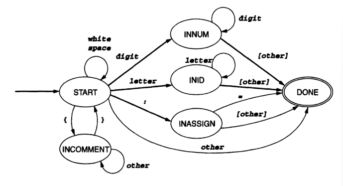
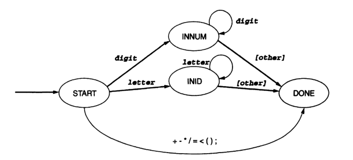

# Lexical Analyzer

## TINY has the following lexical conventions:
- Comments are enclosed in curly brackets {...}
  and cannot be nested.
- White space consists of blanks, tabs, and
  newlines.

## Token Table

| TokenType    | Value/Example   |
| :---   | :---   |
| SEMICOLON | ; |
| IF | if |
| THEN | then |
| END | end |
| REPEAT | repeat |
| UNTIL | until |
| IDENTIFIER | x<br>abc<br>xyz |
| ASSIGN | := |
| READ | read |
| WRITE | write |
| LESSTHAN | < |
| EQUAL | = |
| PLUS | + |
| MINUS | - |
| MULT | * |
| DIV | / |
| OPENBRACKET | ( |
| CLOSEDBRACKET | ) |
| NUMBER | 12 <br> 289 |

## DFA Diagrams

Here are the Deterministic Finite Automaton (DFA) diagrams used for the lexical analysis phase:
### Tiny Scanner Diagram

### Special Symbols Diagram


## Sample Input
A sample TINY language code snippet to test the scanner. Save this as `input.txt`:

```text
{ This is a sample TINY program }
read x;
if x < 12 then
    xyz := x + 289;
    write xyz;
end
```
## Excpected Output
Output that is saved to `tokens.txt`:
```text
read , READ
x , IDENTIFIER
; , SEMICOLON
if , IF
x , IDENTIFIER
< , LESSTHAN
12 , NUMBER
then , THEN
xyz , IDENTIFIER
:= , ASSIGN
x , IDENTIFIER
+ , PLUS
289 , NUMBER
; , SEMICOLON
write , WRITE
xyz , IDENTIFIER
; , SEMICOLON
end , END
